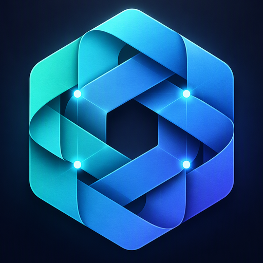
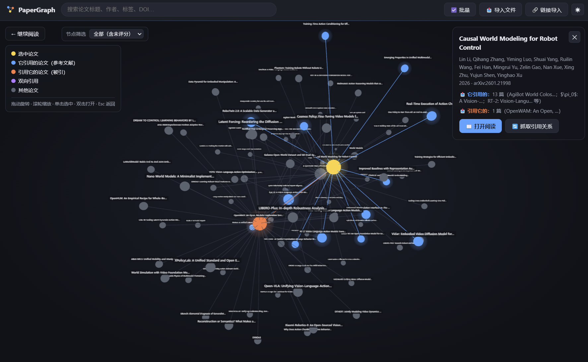
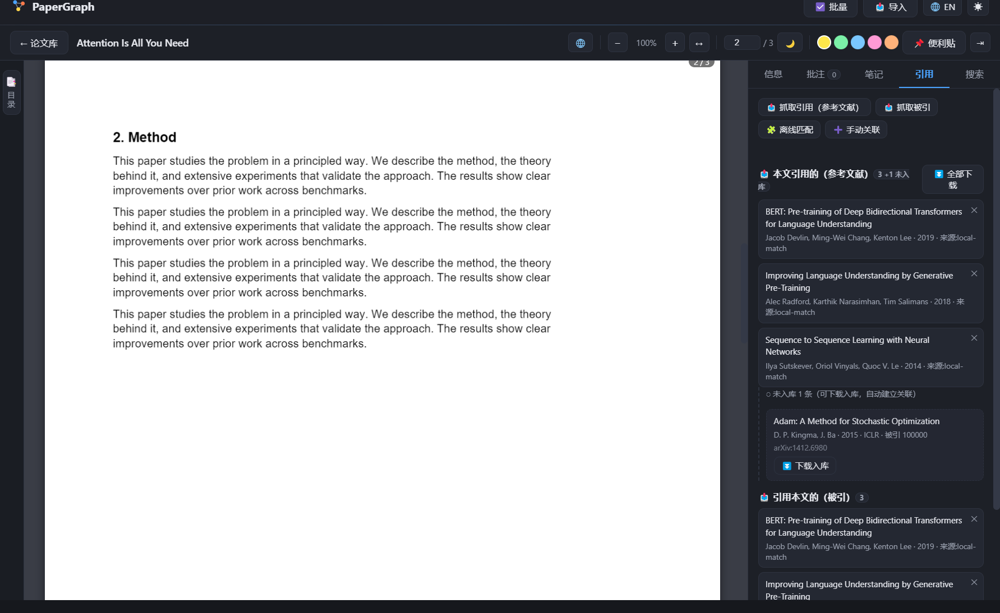
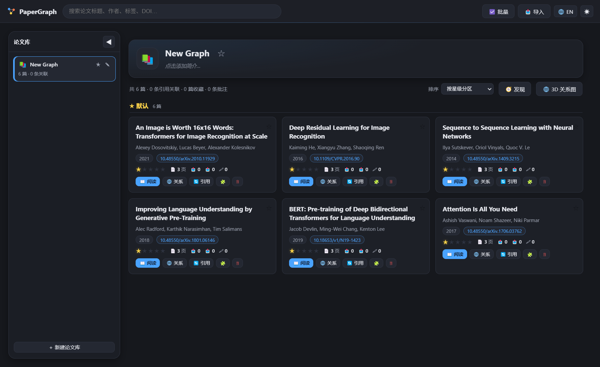
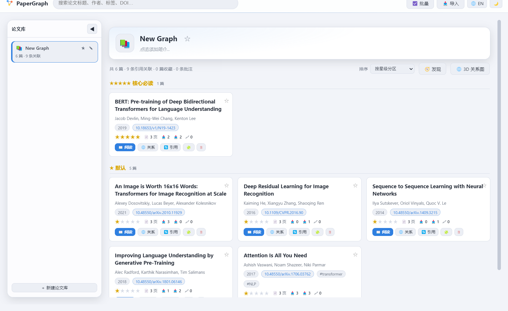
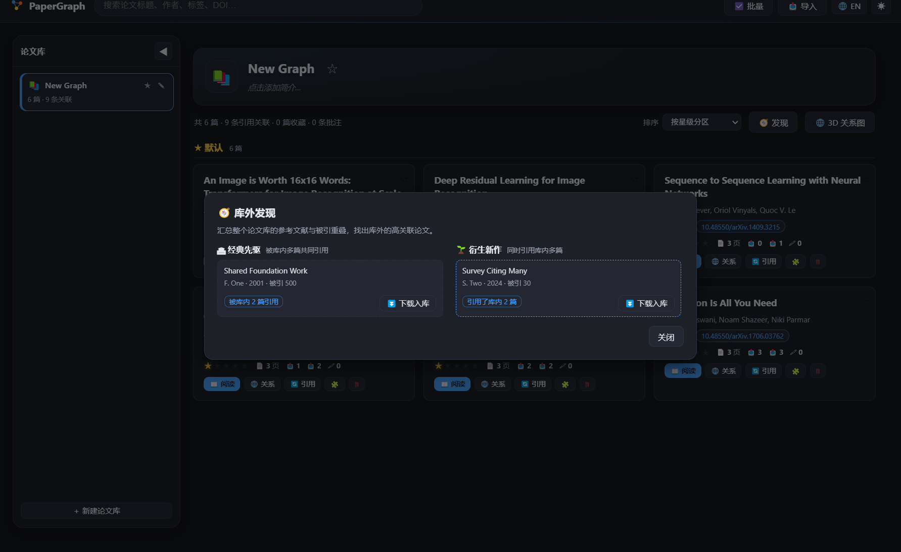

<div align="center">



# PaperWeave

**A lightweight, cross-platform desktop paper reader: read, annotate, rate — and weave your library into an explorable 3D citation network.**

English | [中文](README.md)

[](https://github.com/webDrag0n/PaperWeave/releases/latest)
[](https://github.com/webDrag0n/PaperWeave/actions/workflows/ci.yml)
[](LICENSE)
[](#-download)
[](package.json)



[Download](#-download) · [Quick start](#-quick-start) · [Features](#-features) · [Agent integration](#-agent-integration) · [Development](#-development)

</div>

---

## 📖 Contents

- [Introduction](#-introduction)
- [Features](#-features)
- [Download](#-download)
- [Quick start](#-quick-start)
- [Typical workflow](#-typical-workflow)
- [Agent integration](#-agent-integration)
- [Data & privacy](#-data--privacy)
- [FAQ](#-faq)
- [Development](#-development)
- [Roadmap](#-roadmap)
- [Contributing](#-contributing)
- [License](#-license)

## 💡 Introduction

PaperWeave is built for "reading papers + mapping the field". It is more than a PDF reader: imported papers get their citation relations resolved automatically, weaving your library into an interactive 3D citation network. References that are not yet in your library can be downloaded and linked with one click.

One codebase builds for Windows / macOS / Linux. The frontend is plain ES modules with no build step, and agents can take full control of the library via a local HTTP API or the bundled MCP server.

The app UI switches between Chinese and English (🔤 button in the top bar, preference persisted). Most project documentation is written in Chinese; issues and pull requests in English are welcome.

## ✨ Features

### 📄 Reading & annotation

- **PDF reading**: multi-page rendering, lazy rendering for long documents, smooth Ctrl+wheel zoom centered on the pointer, ↔ fit-width, ← → page navigation, text selection & copy
- **Outline sidebar**: a slim left rail expands into a translucent outline panel; clicking an entry **jumps precisely to the section heading** (outline dest coordinates + title-text-line fallback)
- **Highlights**: a selection toolbar offers 5 colors and comments; click an existing highlight to recolor it, add or edit a comment, or delete it. Comments appear in the page margin with a line to the highlighted text. Highlights and search matches remain text backgrounds; "📌 Sticky notes" can be placed anywhere on a page
- **In-text citation hover cards**: hover a `[1]` or author–year citation in the body text to see the matching reference; open it directly if it is in the library, or download it if it is not
- **Notes**: per-paper Markdown notes with edit/preview toggle and auto-save
- **Reading experience**: per-paper reading position memory (restored on reopen); collapsible side panel for focus reading; 🌙 eye-care mode; ☀️ light / dark themes (graph palette follows the theme)



### ⭐ Library management

- **Multiple libraries**: a collapsible left panel manages libraries as cards — name & description (click ✎ to edit inline), ★ pin to top, drag to reorder, delete requires typing the full name to confirm; the initial default library is always named `New Weave`
- **All downloaded**: inspect the global registry and cross-library links independently of any library, including papers left without a library after deletion; deleting here removes the paper globally
- **Configurable storage**: choose separate PDF and data directories in "⚙ Settings"; existing files are copied and originals kept, PDF changes apply immediately, and data-directory changes apply after restart
- **Unified import**: one "📥 Import" modal handles pasted links (direct PDF / arXiv), drag-and-drop files, and click-to-browse multi-select; multiple links download in parallel with adaptive concurrency and live progress
- **One unified paper store**: each paper is stored once globally (same id reused across libraries); a library only holds paper ids and its own citation links
- **Smart dedupe**: content-hash hits are reused directly; same DOI (possibly different versions) or very similar titles trigger a **confirmation dialog** — reuse the existing paper or import as new
- **Automatic metadata**: title / authors / DOI / abstract / references section extracted on import; publication years prefer arXiv ids and explicit publication markers instead of arbitrary four-digit numbers in the body
- **Importance rating**: 1–5 stars right on the card; manual imports default to 1 star, citation-downloaded papers default to unrated
- **Rating sections & sorting**: grouped by rating by default (★★★★★ → ☆ unrated); sortable by recency / year / title / link count
- Search, tags, favorites, bulk management; **titles support inline Markdown** (`**bold**`, `*italic*`, `` `code` ``, `~~strike~~`)




### 🌐 Citation graph & timeline

- Force-directed 3D graph; all paper labels always visible (inline-Markdown aware); node glow; smooth camera transitions
- **Hop-depth slider** (1–5, default 2): 🟡 selected paper, neighbors colored per hop (blue/orange/purple/green/pink), nodes beyond N hops stay gray
- **Shift+click multi-select**: the network view outlines shortest paths, while the timeline highlights all citation paths between selected papers (without overriding hop colors); hop distance is measured from the nearest selected node
- **2D timeline view**: papers laid out by publication year, with unknown years in their own column; wheel zooms both axes, Shift zooms horizontally, Ctrl zooms vertically
- **Upstream / downstream lineage**: for a single paper, recursively shows its references and citing papers while leaving out side branches
- Combine rating and multi-select author filters; click an author in the paper details to toggle that filter. Enter from the library toolbar / reader toolbar / card "Graph" button — exiting returns to where you came from (Esc works too)
- Drag to rotate · scroll to zoom · click to select · double-click to open

### 🔗 Citation engine

- **Resolve on import**: every imported/downloaded paper gets its citation relations resolved automatically in the background; the reader and graph side panel show live progress, restored after switching views while work is still running
- **Fetch references**: prefers Semantic Scholar's structured references (paginated, most accurate); falls back to parsing the PDF references section (`[1]` / `1.` / `[Vaswani+17]` / unnumbered lists, institutional authors, hyphenated line breaks, appendix cut-off; deduplicated), resolving each entry via DOI (CrossRef) / arXiv / S2 title match / OpenAlex
- **Fetch citations**: Semantic Scholar (throttled with backoff), automatic OpenAlex fallback with pagination
- **Not-in-library loop**: resolved-but-absent entries are persisted in the "Refs" panel — **download individually or all at once with adaptive concurrency** (arXiv / OpenAlex open access), auto-linked on import and shown in the graph; background downloads never block reading; papers without OA PDFs or with other failures appear in an expandable top list with reasons and per-item retry
- 🧩 Offline fuzzy matching (no network) and ➕ manual linking as fallbacks

### 🧭 Similarity & discovery

- **Similar papers**: bibliographic coupling (shared references) × co-citation (shared citers) compute in-library similarity; selecting a paper shows its Top 5 similar papers with overlap percentages in the detail panel — click to jump
- **Discover beyond the library**: the "🧭 Discover" button on the library toolbar aggregates reference/citation overlap across the whole library — "🏛 Prior works" lists foundational papers co-cited by multiple library papers but not yet imported; "🌱 Derivative works" lists new papers citing multiple library papers — each downloadable into the library in one click



### 🧩 Browser extension

PaperWeave Connector (Chrome / Edge) saves the paper on the current page to the desktop app in one click. It works on arXiv, PDF pages and publisher pages that carry `citation_*` metadata, lets you pick the target library, and also offers a context-menu entry. The extension finds and connects to the running desktop app on its own. See [`extension/README.md`](extension/README.md) (Chinese) for installation and usage.

## 📦 Download

Pre-built packages are published on [GitHub Releases](https://github.com/webDrag0n/PaperWeave/releases/latest):

| File | Notes |
| --- | --- |
| `PaperWeave-<version>-win-x64-setup.exe` | Windows NSIS installer (custom install dir) |
| `PaperWeave-<version>-win-x64-portable.exe` | Windows portable build, no installation required |
| `PaperWeave-Connector-<version>.zip` | Chrome / Edge browser extension |

- The Windows packages are not code-signed, so SmartScreen warns on first launch; choose "More info → Run anyway".
- There are no pre-built macOS or Linux packages yet; [build from source](#-development).
- Per-version changes are listed in [CHANGELOG.md](CHANGELOG.md) and [`docs/releases/`](docs/releases/) (Chinese).

## 🚀 Quick start

### Pre-built

1. Download and run the installer or the portable build
2. Drag PDFs into the window, or click "📥 Import" and paste an arXiv link
3. Open a paper to read; click "🌐" to enter the citation graph

### From source

Requires Node.js 18 or later.

```bash
git clone https://github.com/webDrag0n/PaperWeave.git && cd PaperWeave
npm install          # Electron, pdf.js, three.js
npm start            # Desktop app (Electron)
npm run dev          # Browser preview at http://localhost:7100/ (sample data auto-loaded)
```

## 🧭 Typical workflow

1. **Build the library**: drag in PDFs (or paste arXiv links) — metadata and citation links resolve automatically
2. **Deep read**: outline sidebar jumps → highlight key sentences → sticky notes for questions → Markdown notes for summaries
3. **Map the field**: card "Graph" → slider for the 2-hop neighborhood → Shift-select core papers in the timeline to see all citation paths → one-click download of high-impact references not yet in the library
4. **Triage**: rate papers with stars; the library groups by rating and the graph filters by it

## 🤖 Agent integration

PaperWeave offers two agent interfaces. The full contract and its version history are in [`agents/AGENTS.md`](agents/AGENTS.md) (Chinese):

- **Local HTTP Agent API** (`127.0.0.1:24680`, `X-PaperWeave-Token` auth): library management, import, annotations, notes, citation fetch & download, graph snapshot, live progress polling
- **MCP stdio server** (`mcp/paperweave-mcp.js`, zero-dependency single file): works with Claude Desktop / Cursor / Kimi etc.; tools mirror the HTTP API, plus resources and prompt workflow templates (deep-read / survey / import-and-link)

```jsonc
// MCP host configuration example
{
  "mcpServers": {
    "paperweave": { "command": "node", "args": ["<absolute path to paperweave-mcp.js>"] }
  }
}
```

Connection info (port + token) is written to `paperweave-data/agent-api.json` on startup; portable builds also write it next to the exe, along with copies of `AGENTS.md` and `paperweave-mcp.js`.

> The repository has two `AGENTS.md` files: [`agents/AGENTS.md`](agents/AGENTS.md) is for agents that **use** PaperWeave and ships with the app; the root [`AGENTS.md`](AGENTS.md) is for agents that **modify this codebase**.

## 🗂 Data & privacy

- **Fully local-first**: library, annotations, notes and ratings stay on your machine; no telemetry, no cloud sync
- Desktop data lives in `paperweave/paperweave-data/` under the user-data directory:
  - `data.json` app config & library list; `papers.json` global paper registry; `annotations.json` annotations
  - `libraries/<id>.json` per-library paper ids & citation links; `library/` shared PDF store (content-hash named)
  - Windows: `C:\Users\<you>\AppData\Roaming\paperweave\paperweave-data\`
  - macOS: `~/Library/Application Support/paperweave/paperweave-data/`
  - Linux: `~/.config/paperweave/paperweave-data/`
- Browser preview uses localStorage + IndexedDB
- Citation fetching only talks to public scholarly APIs (Semantic Scholar / OpenAlex / CrossRef / arXiv)
- The Agent API listens on the loopback interface only. The security model, known limitations and how to report a vulnerability are in [SECURITY.md](SECURITY.md)

## ❓ FAQ

**Rate limited while fetching citations?**
Semantic Scholar's unauthenticated quota is a shared pool (~1 req/s) and may 429 at peak times. The app throttles and backs off automatically, falling back to OpenAlex. For a stable quota, set `PAPERWEAVE_S2_API_KEY=<your S2 API key>` before launching (free from Semantic Scholar).

**Don't want auto citation resolution on import?**
Start with `PAPERWEAVE_AUTOFETCH=0`; manual fetch remains available in the "Refs" tab.

**A reference fails to download?**
Downloads use arXiv direct links and OpenAlex open-access locations. Failures are listed with reasons at the top of the "Refs" tab and can be retried individually. You can also download manually, import, then click "In library · Link" to connect them.

**macOS / Linux installers?**
On macOS run `./tools/build-mac.sh` (or `npm run dist:mac`); on Linux run `npm run dist:linux` for AppImage / deb. Without an Apple Developer certificate the macOS build is ad-hoc signed: it runs on the machine that built it, and other Macs must allow it in System Settings → Privacy & Security.

## 🛠 Development

The frontend is plain ES modules with no build step, the main process is CommonJS, and the only runtime dependencies are pdf.js and three.js.

```bash
npm start            # Desktop app
npm run dev          # Browser preview
npm test             # Fast suites: plain Node, no Electron
npm run test:e2e     # Full regression: launches Electron; selftest opens a window and takes focus
npm run dist:win     # Build the Windows installer and portable exe (dist:mac / dist:linux likewise)
```

The documents below are written in Chinese.

| Document | Contents |
| --- | --- |
| [docs/architecture.md](docs/architecture.md) | Architecture, module responsibilities, data model, core flows, security boundary, design decisions, known limitations |
| [docs/development.md](docs/development.md) | Setup, commands, code conventions, checklists per kind of change |
| [docs/testing.md](docs/testing.md) | What each test suite covers, when to run it, CI |
| [docs/releasing.md](docs/releasing.md) | Versioning rules and release steps |
| [agents/AGENTS.md](agents/AGENTS.md) | Agent HTTP API and MCP contract |
| [AGENTS.md](AGENTS.md) | Working rules for coding agents in this repository |
| [CHANGELOG.md](CHANGELOG.md) | Version history |

Full index: [docs/README.md](docs/README.md).

## 🗺 Roadmap

- [x] Citation network timeline view (by publication year)
- [ ] Signed & notarized macOS builds
- [ ] Export highlights and notes to Markdown / BibTeX
- [ ] Zotero library import
- [ ] Cross-library full-text search
- [ ] S2 API key settings UI

## 🤝 Contributing

Issues and pull requests are welcome, in English or Chinese. The workflow, commit convention and merge checklist are in [CONTRIBUTING.md](CONTRIBUTING.md); please report security issues privately as described in [SECURITY.md](SECURITY.md).

Run at least `npm test` before submitting. Run `npm run test:e2e` as well when a change touches the UI, IPC, the Agent API or storage. Any change to endpoints, data fields or behavior must update `agents/AGENTS.md` and bump the API version.

## 📄 License

[MIT](LICENSE) © PaperWeave contributors
