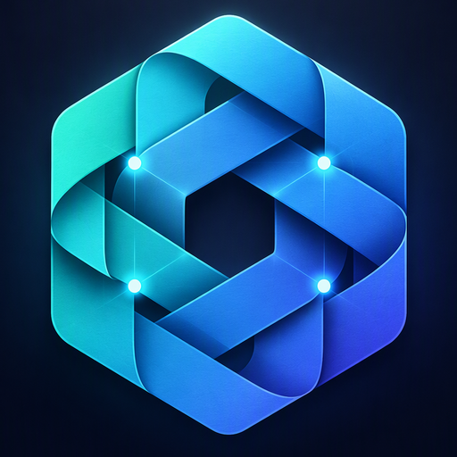
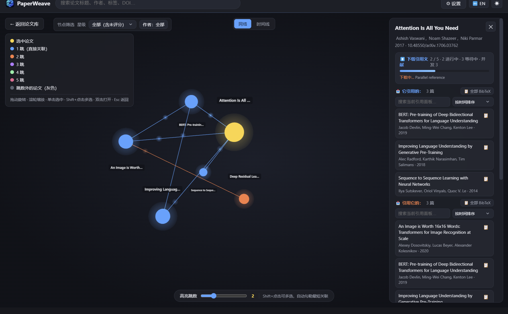
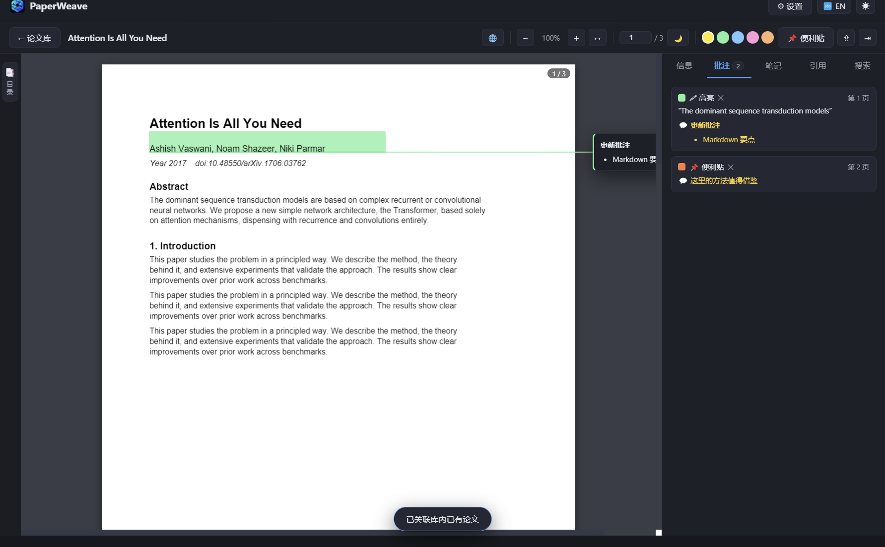
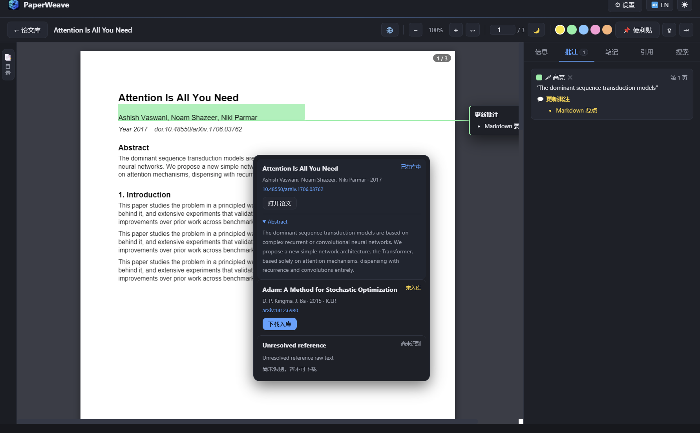
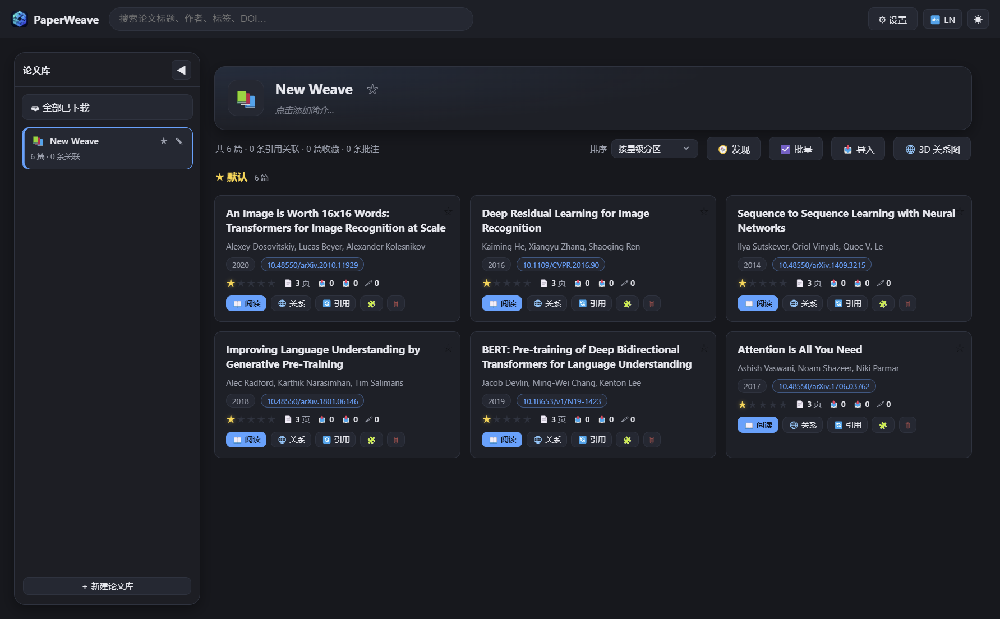
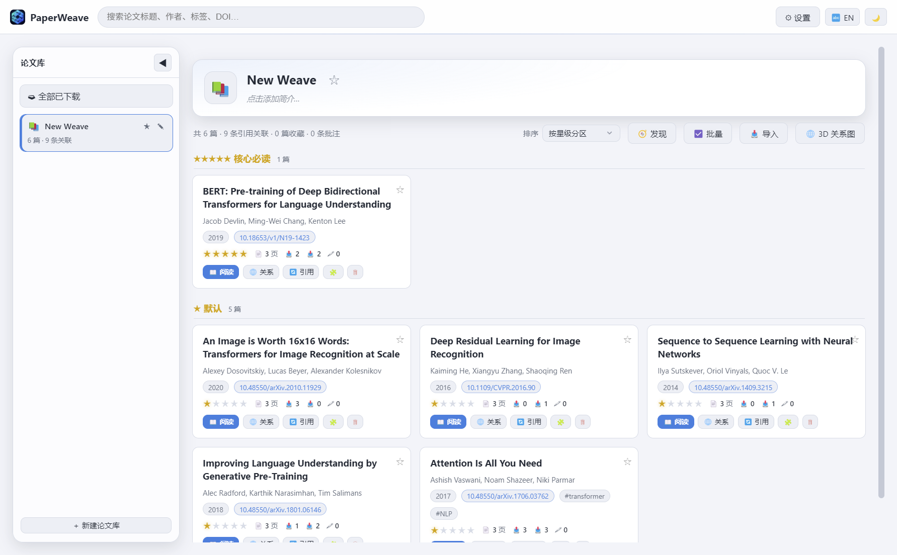
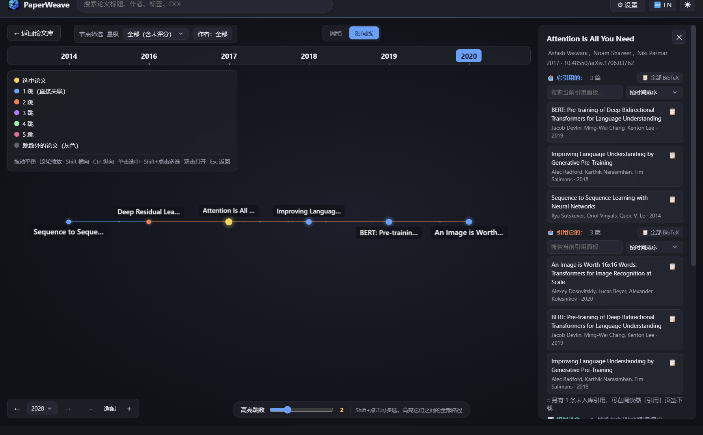
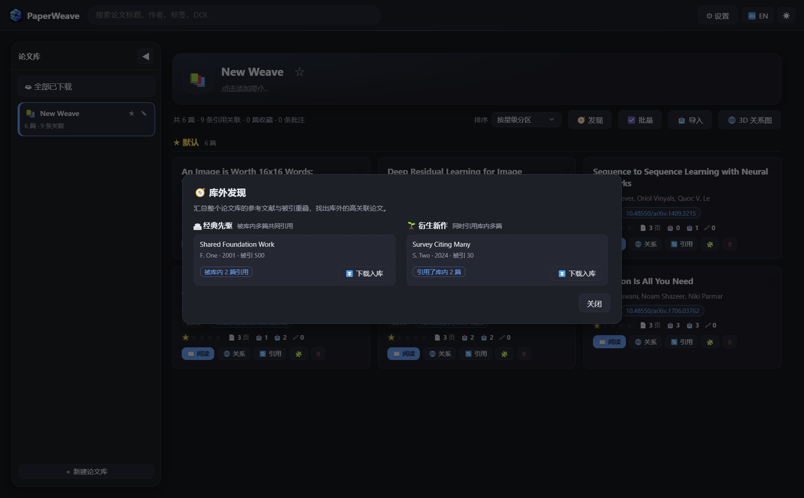

<div align="center">



# PaperWeave

**A lightweight, cross-platform desktop paper reader: read, annotate, rate — and weave your library into an explorable 3D citation network.**

English | [中文](README.md)

[](https://github.com/webDrag0n/PaperWeave/releases/latest)
[](https://github.com/webDrag0n/PaperWeave/actions/workflows/ci.yml)
[](LICENSE)
[](#-download)
[](package.json)



[Download](#-download) · [Quick start](#-quick-start) · [Features](#-features) · [Agent integration](#-agent-integration) · [Development](#-development)

</div>

---

## 📖 Contents

- [Introduction](#-introduction)
- [Features](#-features)
- [Download](#-download)
- [Quick start](#-quick-start)
- [Typical workflow](#-typical-workflow)
- [Agent integration](#-agent-integration)
- [Data & privacy](#-data--privacy)
- [FAQ](#-faq)
- [Development](#-development)
- [Roadmap](#-roadmap)
- [Contributing](#-contributing)
- [License](#-license)

## 💡 Introduction

PaperWeave is built for "reading papers + mapping the field". It is more than a PDF reader: imported papers get their citation relations resolved automatically, weaving your library into an interactive 3D citation network. References that are not yet in your library can be downloaded and linked with one click.

One codebase builds for Windows / macOS / Linux. The frontend is plain ES modules with no build step, and agents can take full control of the library via a local HTTP API or the bundled MCP server.

The app UI switches between Chinese and English (🔤 button in the top bar, preference persisted). Most project documentation is written in Chinese; issues and pull requests in English are welcome.

## ✨ Features

### 📄 Reading, annotation & notes

- **Smooth reading**: lazy rendering for long documents, pointer-centered smooth zoom, fit-width, precise outline jumps and reading-position memory; collapsible side panel, eye-care, light / dark themes and a Chinese / English UI
- **Highlights plus underlines**: five highlight colors keep their background while comments add a colored underline; overlapping underlines get separate lanes, and widely spaced leaders connect Markdown margin cards so same-color annotations remain distinguishable
- **Markdown comments & sticky notes**: edit and preview comments in the margin and annotation list, place sticky notes anywhere, and keep auto-saved Markdown notes for each paper
- **In-paper search**: search selected text with one click or press `Ctrl+F` to search the whole PDF and jump to matches
- **Restorable annotation packages**: export a `.pwpackage` with the original PDF, metadata and all annotations, then restore it from the import dialog; annotations merge with existing ones by ID
- **Citation hover cards**: hover a `[1]` or author–year citation to inspect it; open papers already in the library or download missing ones




### ⭐ Library, search & sorting

- **Multiple libraries**: manage names, descriptions, icons, pinned state and drag order; "All downloaded" aggregates papers and links across libraries
- **Unified import & dedupe**: local PDFs, drag-and-drop, URLs / arXiv and the browser extension; content hashes reuse papers, while DOI or highly similar title conflicts ask for confirmation
- **Automatic metadata**: extract title, authors, DOI, abstract and references; publication years prefer arXiv ids and explicit publication markers
- **Sections plus sorting within each**: group by rating, year added, publication year, title initial, author initial or citation count; search results retain the same sections
- **Paper management**: search, tags, favorites, bulk selection, 1–5 star ratings and inline-Markdown titles
- **Configurable local storage**: choose separate PDF and data directories without deleting originals; parallel startup loading renders the first cards before annotation counts finish in the background




### 🌐 Citation graph & timeline

- **3D citation network**: force-directed layout, node glow and hop colors; camera fitting respects node and label boundaries, and rotation stays centered on the node centroid
- **Multi-select paths**: shortest paths in the network view, or all citation paths between selected papers in the timeline
- **Aligned time ticks**: papers are grouped by publication year, and the ruler stays aligned while panning; zoom both axes independently or together
- **Search all nodes**: the top search highlights every match and dims the rest instead of focusing only the first result
- **Filters & lineage**: combine rating and multi-author filters, or recursively inspect a paper's complete upstream and downstream history
- **Searchable relation panels**: reader and graph-side reference/citation lists support independent search and sorting by year, author initial or title initial



### 🔗 Citation engine & discovery

- **Automatic citation resolution**: Semantic Scholar structured data first, with PDF reference parsing as fallback; numbered and unnumbered entries, institutional authors and hyphenated line breaks are supported, and citation fetching can fall back to OpenAlex
- **Close the missing-paper loop**: download individual or batched references, then auto-link them into the graph; failures include reasons and retry, with offline matching and manual linking as fallbacks
- **Similar papers**: shared references and shared citers produce a Top 5 list with overlap scores in the detail panel
- **Discover beyond the library**: aggregate citation overlap to find prior works and derivative papers, then download them into the library in one click



### 🧩 Browser extension

PaperWeave Connector (Chrome / Edge) saves the paper on the current page to the desktop app in one click. It works on arXiv, PDF pages and publisher pages that carry `citation_*` metadata, lets you pick the target library, and also offers a context-menu entry. The extension finds and connects to the running desktop app on its own. See [`extension/README.md`](extension/README.md) (Chinese) for installation and usage.

## 📦 Download

Pre-built packages are published on [GitHub Releases](https://github.com/webDrag0n/PaperWeave/releases/latest):

| File | Notes |
| --- | --- |
| `PaperWeave-<version>-win-x64-setup.exe` | Windows NSIS installer (custom install dir) |
| `PaperWeave-<version>-win-x64-portable.exe` | Windows portable build, no installation required |
| `PaperWeave-Connector-<version>.zip` | Chrome / Edge browser extension |

- The Windows packages are not code-signed, so SmartScreen warns on first launch; choose "More info → Run anyway".
- There are no pre-built macOS or Linux packages yet; [build from source](#-development).
- Per-version changes are listed in [CHANGELOG.md](CHANGELOG.md) and [`docs/releases/`](docs/releases/) (Chinese).

## 🚀 Quick start

### Pre-built

1. Download and run the installer or the portable build
2. Drag PDFs into the window, or click "📥 Import" and paste an arXiv link
3. Open a paper to read; click "🌐" to enter the citation graph

### From source

Requires Node.js 18 or later.

```bash
git clone https://github.com/webDrag0n/PaperWeave.git && cd PaperWeave
npm install          # Electron, pdf.js, three.js
npm start            # Desktop app (Electron)
npm run dev          # Browser preview at http://localhost:7100/ (sample data auto-loaded)
```

## 🧭 Typical workflow

1. **Build the library**: drag in PDFs (or paste arXiv links) — metadata and citation links resolve automatically
2. **Deep read**: outline sidebar jumps → highlight key sentences → sticky notes for questions → Markdown notes for summaries
3. **Map the field**: card "Graph" → slider for the 2-hop neighborhood → Shift-select core papers in the timeline to see all citation paths → one-click download of high-impact references not yet in the library
4. **Triage**: rate papers with stars; the library groups by rating and the graph filters by it

## 🤖 Agent integration

PaperWeave offers two agent interfaces. The full contract and its version history are in [`agents/AGENTS.md`](agents/AGENTS.md) (Chinese):

- **Local HTTP Agent API** (`127.0.0.1:24680`, `X-PaperWeave-Token` auth): library management, paged PDF text and quote search, annotations, notes, citation fetch and download, cross-library graph data, and progress polling
- **MCP stdio server** (`mcp/paperweave-mcp.js`, zero-dependency single file): works with Claude Desktop / Cursor / Kimi etc.; exposes paged text, original PDF resources, search, highlighting, and library tools, plus research-assistant guidance and workflows for close reading, reviews, insights, and interest-based highlights

```jsonc
// MCP host configuration example
{
  "mcpServers": {
    "paperweave": { "command": "node", "args": ["<absolute path to paperweave-mcp.js>"] }
  }
}
```

Connection info (port + token) is written to `paperweave-data/agent-api.json` on startup; portable builds also write it next to the exe, along with copies of `AGENTS.md` and `paperweave-mcp.js`.

> The repository has two `AGENTS.md` files: [`agents/AGENTS.md`](agents/AGENTS.md) is for agents that **use** PaperWeave and ships with the app; the root [`AGENTS.md`](AGENTS.md) is for agents that **modify this codebase**.

## 🗂 Data & privacy

- **Fully local-first**: library, annotations, notes and ratings stay on your machine; no telemetry, no cloud sync
- Desktop data lives in `paperweave/paperweave-data/` under the user-data directory:
  - `data.json` app config & library list; `papers.json` global paper registry; `annotations.json` annotations
  - `libraries/<id>.json` per-library paper ids & citation links; `library/` shared PDF store (content-hash named)
  - Windows: `C:\Users\<you>\AppData\Roaming\paperweave\paperweave-data\`
  - macOS: `~/Library/Application Support/paperweave/paperweave-data/`
  - Linux: `~/.config/paperweave/paperweave-data/`
- Browser preview uses localStorage + IndexedDB
- Citation fetching only talks to public scholarly APIs (Semantic Scholar / OpenAlex / CrossRef / arXiv)
- The Agent API listens on the loopback interface only. The security model, known limitations and how to report a vulnerability are in [SECURITY.md](SECURITY.md)

## ❓ FAQ

**Rate limited while fetching citations?**
Semantic Scholar's unauthenticated quota is a shared pool (~1 req/s) and may 429 at peak times. The app throttles and backs off automatically, falling back to OpenAlex. For a stable quota, set `PAPERWEAVE_S2_API_KEY=<your S2 API key>` before launching (free from Semantic Scholar).

**Don't want auto citation resolution on import?**
Start with `PAPERWEAVE_AUTOFETCH=0`; manual fetch remains available in the "Refs" tab.

**A reference fails to download?**
Downloads use arXiv direct links and OpenAlex open-access locations. Failures are listed with reasons at the top of the "Refs" tab and can be retried individually. You can also download manually, import, then click "In library · Link" to connect them.

**macOS / Linux installers?**
On macOS run `./tools/build-mac.sh` (or `npm run dist:mac`); on Linux run `npm run dist:linux` for AppImage / deb. Without an Apple Developer certificate the macOS build is ad-hoc signed: it runs on the machine that built it, and other Macs must allow it in System Settings → Privacy & Security.

## 🛠 Development

The frontend is plain ES modules with no build step, the main process is CommonJS, and the only runtime dependencies are pdf.js and three.js.

```bash
npm start            # Desktop app
npm run dev          # Browser preview
npm test             # Fast suites: plain Node, no Electron
npm run test:e2e     # Full regression: launches Electron; selftest opens a window and takes focus
npm run dist:win     # Build the Windows installer and portable exe (dist:mac / dist:linux likewise)
```

The documents below are written in Chinese.

| Document | Contents |
| --- | --- |
| [docs/architecture.md](docs/architecture.md) | Architecture, module responsibilities, data model, core flows, security boundary, design decisions, known limitations |
| [docs/development.md](docs/development.md) | Setup, commands, code conventions, checklists per kind of change |
| [docs/testing.md](docs/testing.md) | What each test suite covers, when to run it, CI |
| [docs/releasing.md](docs/releasing.md) | Versioning rules and release steps |
| [agents/AGENTS.md](agents/AGENTS.md) | Agent HTTP API and MCP contract |
| [AGENTS.md](AGENTS.md) | Working rules for coding agents in this repository |
| [CHANGELOG.md](CHANGELOG.md) | Version history |

Full index: [docs/README.md](docs/README.md).

## 🗺 Roadmap

- [x] Citation network timeline view (by publication year)
- [ ] Signed & notarized macOS builds
- [ ] Export highlights and notes to Markdown / BibTeX
- [ ] Zotero library import
- [ ] Cross-library full-text search
- [ ] S2 API key settings UI

## 🤝 Contributing

Issues and pull requests are welcome, in English or Chinese. The workflow, commit convention and merge checklist are in [CONTRIBUTING.md](CONTRIBUTING.md); please report security issues privately as described in [SECURITY.md](SECURITY.md).

Run at least `npm test` before submitting. Run `npm run test:e2e` as well when a change touches the UI, IPC, the Agent API or storage. Any change to endpoints, data fields or behavior must update `agents/AGENTS.md` and bump the API version.

## 📄 License

[MIT](LICENSE) © PaperWeave contributors
