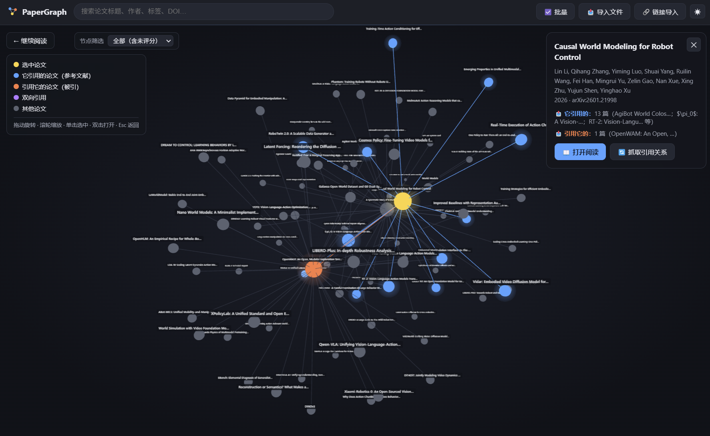
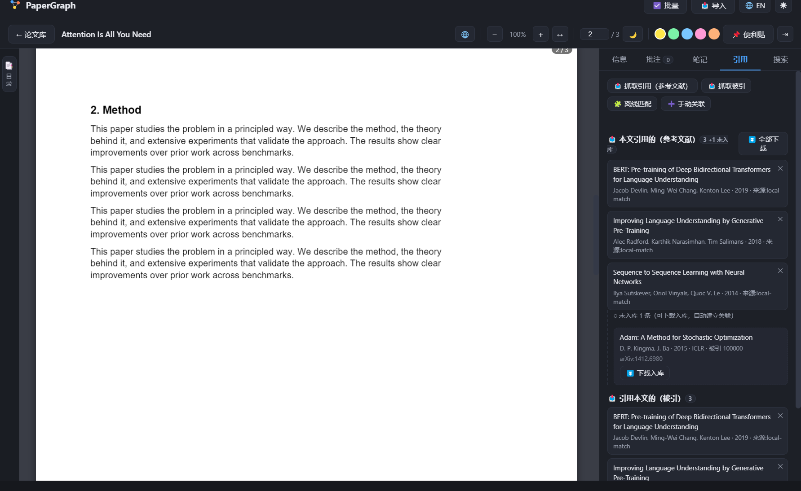
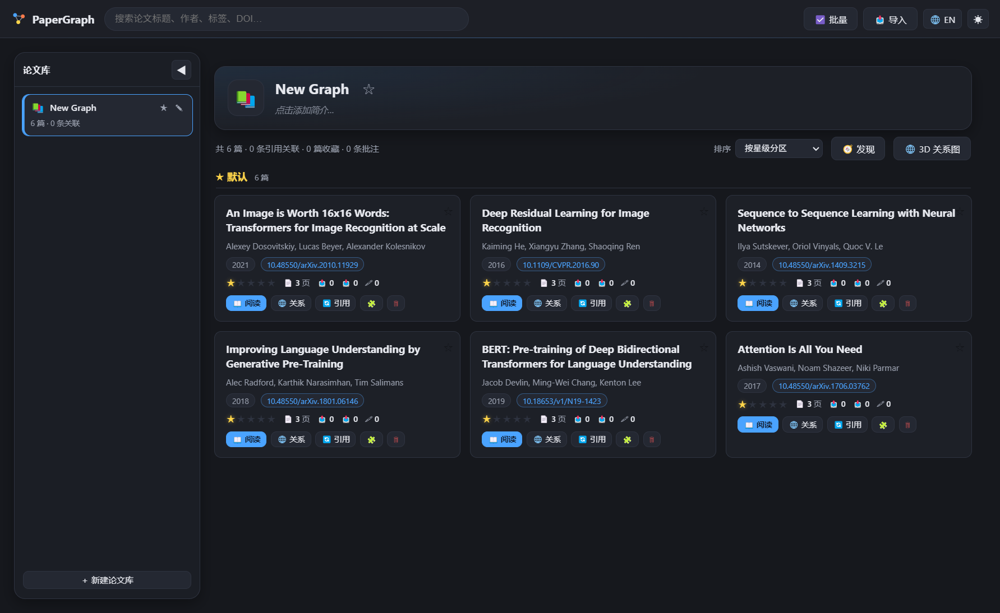
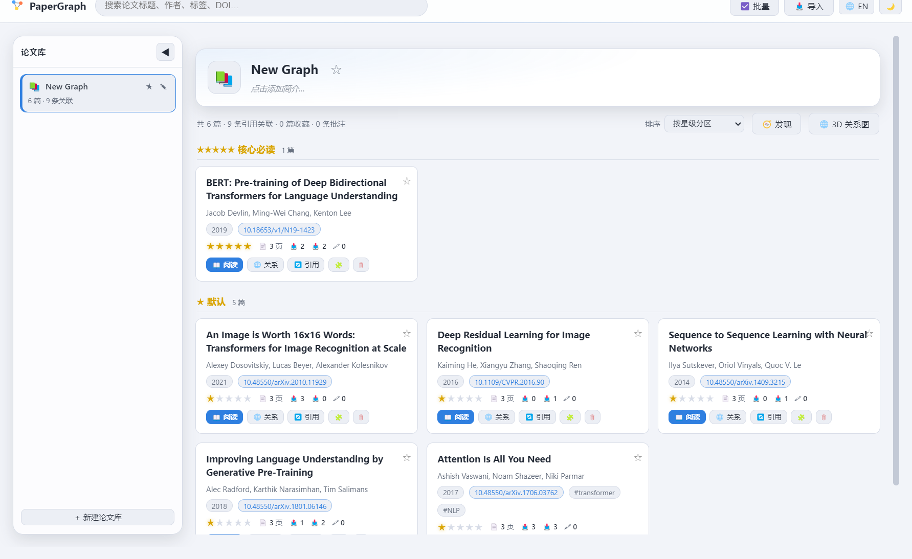
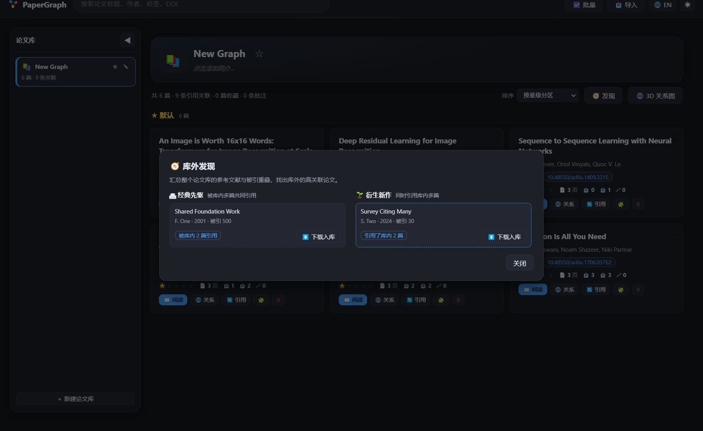

<div align="center">


# PaperWeave

**轻量、跨平台的桌面论文阅读器：阅读、批注、评星，并把论文库织成一张可探索的 3D 引用网络。**

[English](README.en.md) | 中文

[](release/)
[](LICENSE)
[](#-下载)
[](package.json)
[](#-测试与质量)



[下载](#-下载) · [快速开始](#-快速开始) · [功能亮点](#-功能亮点) · [Agent 集成](#-agent-集成) · [开发文档](#-开发)

</div>

---

## 📖 目录

- [简介](#-简介)
- [功能亮点](#-功能亮点)
- [下载](#-下载)
- [快速开始](#-快速开始)
- [典型工作流](#-典型工作流)
- [Agent 集成](#-agent-集成)
- [测试与质量](#-测试与质量)
- [打包发布](#-打包发布)
- [数据与隐私](#-数据与隐私)
- [技术架构](#-技术架构)
- [常见问题](#-常见问题)
- [路线图](#-路线图)
- [贡献](#-贡献)
- [许可证](#-许可证)

## 💡 简介

PaperWeave 是为「读论文 + 理脉络」而生的桌面工具：它不只是一个 PDF 阅读器——导入论文后会自动解析引用关系，把论文库织成一张可交互的 3D 引用网络；遇到未收录进库的参考文献，可以一键下载入库并自动挂到网络里。

同一套源码编译 Windows / macOS / Linux 三平台产物；纯 ES Module 前端无构建步骤，Agent 可通过本地 HTTP API 或 MCP Server 全权接管论文库。

## ✨ 功能亮点

### 📄 阅读与批注

- **PDF 阅读**：多页渲染、长文档懒加载秒开、Ctrl+滚轮缩放、↔ 适应宽度、← → 翻页、文本选择复制
- **目录侧边栏**：左侧窄条展开半透明目录面板，点击条目**精确定位到子段落标题处**（大纲 dest 坐标 + 标题文本行双重定位）
- **高亮批注**：选中文字弹出工具条，5 色高亮 + 文字批注；「📌 便利贴」可在页面任意位置放置便签
- **论文笔记**：每篇论文支持 Markdown 笔记，编辑 / 预览切换，自动保存
- **阅读体验**：自动记忆每篇阅读位置并在重开时恢复；右侧面板一键收起专注阅读；🌙 护眼模式；☀️ 浅色 / 深色主题（3D 图谱配色联动）；🌐 界面中英双语切换（顶栏按钮，偏好持久化）



### ⭐ 论文库管理

- **多论文库**：左侧论文库面板（可展开/缩回）以卡片管理多个论文库——卡片显示名称与简介（点击 ✎ 直接编辑）、★ 星标置顶、拖动排序、删除需输入完整名称确认；默认初始库名称为 `New Graph`
- **统一导入**：一个「📥 导入」弹窗同时支持粘贴链接（PDF 直链 / arXiv）、拖入文件、点击打开文件管理器多选
- **统一论文存储**：同一篇论文全局仅存一份（唯一 id 跨库复用），论文库只记录包含哪些论文及库内引用关联
- **智能去重**：导入时内容 hash 命中直接复用；DOI 相同（可能不同版本）或标题高度相似时**弹窗请你确认**——复用已有论文或作为新论文导入
- **自动元数据**：标题 / 作者 / DOI / 摘要 / 参考文献段落自动提取
- **重要性评星**：1–5 星卡片上直接点星；手动导入默认 1 星，引用自动下载的文献默认未评分
- **星级分区与排序**：默认按星级分区（★★★★★ → ☆ 未评分），可切换最新添加 / 年份 / 标题 / 引用关联数排序
- 搜索、标签、收藏、批量管理一应俱全；**标题支持行内 Markdown**（`**粗**`、`*斜*`、`` `代码` ``、`~~删~~`）




### 🌐 3D 引用关系图

- 力导向 3D 图谱，全部论文标签常显，节点辉光，相机平滑过渡
- **跳数高亮滑条**（1–5，默认 2）：🟡 选中论文，N 跳邻居按跳数分色（蓝/橙/紫/绿/粉），跳数外置灰
- **Shift+点击多选**：自动以轮廓环 + 亮线勾勒多篇论文之间的最短关联（不覆盖跳数颜色）
- 按星级过滤节点（全部 / ≥N 星 / 仅 5 星）；从论文库 / 阅读器 / 卡片进入，退出时原路返回
- 拖动旋转 · 滚轮缩放 · 单击选中 · 双击打开阅读

### 🔗 引用关系引擎

- **导入即解析**：任何论文入库后自动后台解析引用关系，不打断当前操作
- **抓取引用（参考文献）**：优先 Semantic Scholar 结构化参考文献（分页拉取，最准最全）；未收录时回退解析 PDF 参考文献段落（支持 `[1]` / `1.` / `[Vaswani+17]` / 无编号列表，自动去重），逐条经 DOI（CrossRef）/ arXiv / S2 标题匹配 / OpenAlex 检索确认
- **抓取被引**：Semantic Scholar（限流退避），失败自动回退 OpenAlex 分页处理
- **未入库引用闭环**：识别成功但不在库内的条目持久保存在「引用」面板，支持**单篇下载入库或一键全部下载**（arXiv / OpenAlex 开放获取），入库自动建边并出现在图谱中，后台下载不影响阅读
- 🧩 离线模糊匹配（无需网络）与 ➕ 手动关联兜底

### 🧭 相似与库外发现

- **相似论文**：基于文献计量学的文献耦合（共同参考文献）× 同被引（共同引用者）计算库内相似度，选中论文后在详情栏给出 Top 5 相似论文与重叠度百分比，点击即跳转
- **库外发现**：论文库工具条「🧭 发现」汇总全库的参考文献与被引重叠——「🏛 经典先驱」列出被库内多篇共同引用却未入库的奠基论文，「🌱 衍生新作」列出同时引用库内多篇的新论文，均可一键下载入库



## 📦 下载

预构建产物在 [`release/`](release/)（当前 v1.0.0）：

| 文件 | 平台 | 说明 |
| --- | --- | --- |
| `PaperWeave-1.0.0-win-x64-setup.exe` | Windows | NSIS 安装程序（可选安装目录） |
| `PaperWeave-1.0.0-win-x64-portable.exe` | Windows | 便携版，免安装直接运行 |
| `PaperWeave-1.0.0-linux-x64.zip` | Linux | 解压后运行 `PaperWeave` |

macOS 请从源码构建（见[打包发布](#-打包发布)）。

## 🚀 快速开始

### 使用预构建版本

1. 下载并运行对应平台的安装包或便携版
2. 把 PDF 拖进窗口，或点「🔗 链接导入」粘贴 arXiv 链接
3. 打开论文阅读，点「🌐」进入引用关系图

### 从源码运行

```bash
git clone <仓库地址> && cd PaperWeave
npm install          # 安装依赖（Electron、pdf.js、three.js）
npm start            # 启动桌面应用
npm run dev          # 浏览器预览模式（http://localhost:7100/，示例数据自动载入）
```

## 🧭 典型工作流

1. **建库**：拖入一批 PDF（或粘贴 arXiv 链接），元数据与引用关系自动就位
2. **精读**：目录侧边栏跳段落 → 高亮核心句 → 便利贴记录疑问 → Markdown 笔记总结
3. **理脉络**：卡片「关系」进入图谱 → 滑条看 2 跳引用圈 → Shift 多选几篇核心论文看它们的最短关联 → 未入库的高被引参考文献一键下载补库
4. **分级**：读完点星，论文库按星级自动分区，图谱按星级过滤只看核心网络

## 🤖 Agent 集成

PaperWeave 提供两种 Agent 接入方式（详见 [`agents/AGENTS.md`](agents/AGENTS.md)，API v3）：

- **本地 HTTP Agent API**（`127.0.0.1:24680`，`X-PaperWeave-Token` 令牌鉴权）：论文库管理、导入、批注、笔记、引用抓取与下载、图谱读取、实时进度查询
- **MCP stdio Server**（`mcp/paperweave-mcp.js`，零依赖单文件）：Claude Desktop / Cursor / Kimi 等宿主配置 `node paperweave-mcp.js` 即可接入；20 个工具与 HTTP API 一一对应，另有 5 个 Resources 与 3 个 Prompt 工作流模板（精读 / 综述 / 导入建联）

```jsonc
// MCP 宿主配置示例
{
  "mcpServers": {
    "paperweave": { "command": "node", "args": ["<paperweave-mcp.js 的绝对路径>"] }
  }
}
```

连接信息（端口 + 令牌）在启动后写入 `paperweave-data/agent-api.json`；便携版同时写入 exe 同目录，并自动复制 `AGENTS.md` 与 `paperweave-mcp.js`。

## 🧪 测试与质量

三套全量回归，覆盖真实用户操作路径、接口契约与 MCP 协议：

```bash
npm run selftest     # 端到端自测：161 项用户场景（Electron 真实渲染 + 截图存档）
npm run apitest      # Agent HTTP API 自测：47 项接口场景
npm run mcptest      # MCP Server 自测：49 项 stdio 场景
```

- 自测覆盖：导入去重、元数据提取、懒渲染、高亮防重叠、笔记、评星分区排序、跳数分色、多选最短路径、目录侧边栏、阅读位置记忆、引用抓取与下载闭环等
- 截图自动存档至 `shots/`，报告写入 `selftest-report.json`

### 开发约定（必须遵守）

> **每次功能 / 接口更新，都必须同步更新 `agents/AGENTS.md`**：新增或修改接口、数据字段、行为语义时，更新接口文档并递增 API 版本号；打包配置（`extraResources`）会自动把最新版本分发给最终用户。接口行为变更后应同步更新 `tools/api-test.js` / `tools/mcp-test.js` 中的用例，并运行 `npm run apitest` 与 `npm run mcptest` 回归。

## 📦 打包发布

同一套源码，三平台产物：

```bash
npm run dist:win     # Windows：NSIS 安装包 + 便携版 exe
npm run dist:linux   # Linux：AppImage / deb（需在 Linux 上执行；Windows 上可交叉构建 zip）
npm run dist:mac     # macOS：dmg / zip（需在 macOS 上执行，electron-builder 平台限制）
```

> **打包提示**：在 Kimi / Electron 托管的终端里构建时，环境变量 `ELECTRON_RUN_AS_NODE=1` 会让 asar 打包失败，请使用仓库自带的独立 Node：`tools/runtime/node-v24.21.0-win-x64/node.exe tools/build.js --win`。
>
> `tools/build.js` 默认把构建输出放到**系统临时目录**，完成后只把发行物（安装包 / 便携版 / blockmap 等）拷回 `release/`——免安装的 `*-unpacked` 目录不会落进工作区，避免文件监听（Kimi / 编辑器等）长期锁定 `app.asar` 导致下次构建失败。确需免安装目录时用 `npm run pack`，或显式传 `-c.directories.output=<目录>`（这两种情况原样透传给 electron-builder）。

## 🗂 数据与隐私

- **完全本地优先**：论文库、批注、笔记、评星全部存储在本机，无任何遥测与云端上传
- 桌面版数据位于用户数据目录 `paperweave/paperweave-data/`：
  - `data.json` 应用级配置与论文库列表；`papers.json` 全局论文注册表；`annotations.json` 批注
  - `libraries/<id>.json` 每个论文库的论文清单与引用关联；`library/` 全局共享 PDF 文件库（内容 hash 命名）
  - Windows 示例：`C:\Users\<你>\AppData\Roaming\paperweave\paperweave-data\`
  - macOS：`~/Library/Application Support/paperweave/paperweave-data/`
  - Linux：`~/.config/paperweave/paperweave-data/`
- 浏览器预览版使用 localStorage + IndexedDB
- 引用抓取仅访问公开学术 API（Semantic Scholar / OpenAlex / CrossRef / arXiv）

## 🏗 技术架构

```
main/       Electron 主进程：窗口、导入、下载、元数据提取、引用抓取、JSON 存储、Agent HTTP API
  ├─ service.js     业务服务层（IPC 与 Agent API 共用同一实现）
  ├─ refs.js        引用引擎：S2/OpenAlex/CrossRef/arXiv 多源检索、限流退避、外部引用解析
  └─ agent-api.js   本地 HTTP 接口（127.0.0.1 + X-PaperWeave-Token）
preload/    受控 IPC 桥
renderer/   纯 ES Module 前端（无构建步骤）：论文库 / 阅读器 / 3D 图谱 / 笔记
agents/     AGENTS.md（Agent 接口契约文档，随包分发）
mcp/        paperweave-mcp.js（零依赖 MCP stdio Server）
vendor/     pdf.js 与 three.js 静态文件（importmap 直接加载）
tools/      开发服务器、自测运行器（selftest / apitest / mcptest）、打包包装、示例 PDF 生成
```

- PDF 渲染：pdf.js（文本层选择 + 自绘高亮层）
- 3D 图谱：three.js + 手写力导向布局 + OrbitControls
- 存储：JSON 原子写入（损坏自动备份），PDF 按内容 hash 去重入库

## ❓ 常见问题

**抓取引用时被限流 / 失败？**
Semantic Scholar 未认证配额为共享池（约 1 req/s），高峰期可能 429。应用已内置节流与指数退避，并自动回退 OpenAlex；如需稳定高配额，设置环境变量 `PAPERWEAVE_S2_API_KEY=<你的 S2 API Key>` 后启动（免费申请见 Semantic Scholar 官网）。

**不希望导入后自动解析引用？**
设置 `PAPERWEAVE_AUTOFETCH=0` 后启动即可关闭，仍可在「引用」页签手动抓取。

**引用下载失败？**
下载走 arXiv 直链与 OpenAlex 开放获取（OA）位置；无 OA 来源的付费论文会明确报出失败原因，可手动下载后导入，再点「已在库中 · 关联」补建引用边。

**macOS / Linux 安装包？**
macOS 需在 macOS 上执行 `npm run dist:mac`；Linux 的 AppImage/deb 需在 Linux 上执行 `npm run dist:linux`（Windows 上仅交叉构建 zip）。

## 🗺 路线图

- [ ] macOS 签名与公证构建
- [ ] 高亮与笔记导出为 Markdown / BibTeX
- [ ] Zotero 库导入
- [ ] 跨库全文搜索
- [ ] 引用网络时间线视图（按发表年份排布）
- [ ] S2 API Key 设置界面

## 🤝 贡献

欢迎 Issue 与 PR。提交代码前请：

1. 运行 `npm run selftest && npm run apitest && npm run mcptest` 确保三套回归全部通过
2. 遵守[开发约定](#-测试与质量)，同步更新 `agents/AGENTS.md`

## 📄 许可证

[MIT](LICENSE) © PaperWeave
