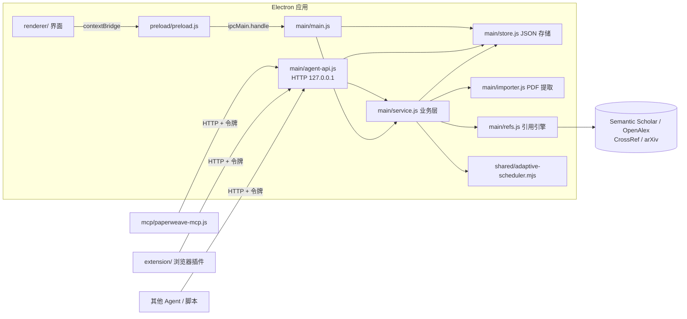

# 架构与设计

本文描述 PaperWeave 的整体设计、模块边界、数据模型和核心流程，面向需要修改代码的开发者与 coding agent。内容以 v1.3.0 源码为准；对外接口的字段级细节以 [`agents/AGENTS.md`](../agents/AGENTS.md) 为准，本文不重复。

## 1. 定位与设计目标

PaperWeave 是本地优先的桌面论文阅读器：阅读与批注 PDF，自动解析引用关系，把论文库呈现为可探索的引用网络，并把同一套能力开放给 AI agent。

设计目标按优先级排列：

1. **本地优先**：论文、批注、笔记全部落在本机 JSON 与 PDF 文件中，无账号、无遥测、无云端。
2. **Agent 一等公民**：界面能做的事，agent 通过本地 HTTP API 或 MCP 也能做，两条入口共用同一业务实现。
3. **零构建前端**：渲染进程是原生 ES Module，改完刷新即可，没有打包器和转译步骤。
4. **依赖极少**：运行时依赖只有 `pdfjs-dist` 与 `three`；MCP Server 和浏览器插件零依赖。

## 2. 运行形态

| 形态 | 入口 | 数据位置 | 用途 |
| --- | --- | --- | --- |
| 桌面应用 | `npm start` → `main/main.js` | `<userData>/paperweave-data/` | 正式产品 |
| 浏览器预览 | `npm run dev` → `tools/dev-server.js` | localStorage + IndexedDB | 快速预览界面、联调网页桥接层 |
| 外部客户端 | MCP Server、浏览器插件、任意 HTTP 客户端 | 无自有数据，全部经 Agent API | Agent 与网页入库 |

浏览器预览与桌面应用加载同一份 `renderer/`，差异全部收敛在 `renderer/bridge.js`：存在 `window.paperweave`（preload 注入）时走 IPC，否则走网页实现。
`PAPERWEAVE_HEADLESS=1` 供 API/MCP 测试使用：主进程启动存储与 Agent API，但不创建渲染窗口，并让 GPU 留在进程内以避开部分 Windows 环境的 GPU 子进程崩溃。

## 3. 总体结构



读写单个字段这类简单操作，IPC 与 HTTP 两条入口都直接调用 `Store`；包含流程的操作（导入、引用抓取、下载）必须经过 `service.js`，这样界面与 agent 的行为才保持一致。

### 模块职责

**主进程 `main/`**（CommonJS）

| 文件 | 职责 |
| --- | --- |
| `main.js` | 入口。注册 `app://` 协议、IPC 通道、启动 Agent API、迁移与配置数据目录、自测钩子 |
| `store.js` | `Store` 类：JSON 文件读写、多论文库、全局论文与关系统计、引用边、批注、字段迁移、存储目录复制 |
| `service.js` | `createService(store, opts)`：导入与去重、冲突处理、引用抓取、引用下载与失败记录、导入后自动抓取队列 |
| `importer.js` | 用 pdf.js（Node legacy 构建）提取标题、作者、DOI、摘要、参考文献段落；PDF 按内容哈希落盘 |
| `pubyear.js` | 发表年份推断：arXiv 编号、首页出版标记、受参考文献约束的 PDF 创建日期；网页镜像为 `renderer/pubyear.js` |
| `refs.js` | 引用引擎：参考文献条目切分、多数据源检索、限流与退避、库内匹配、开放获取 PDF 定位 |
| `citation-index.js` | 正文引用悬浮所用的本地索引，纯计算，不联网 |
| `download-queue.js` | 以动态 `import()` 懒加载共享调度器，供 CommonJS 侧使用 |
| `agent-api.js` | 本地 HTTP 接口：路由、令牌鉴权、CORS、插件配对、连接信息文件 |

**预加载 `preload/preload.js`**：通过 `contextBridge` 暴露 `window.paperweave`，是渲染进程访问主进程的唯一通道。

**渲染进程 `renderer/`**（ES Module，无构建）

| 文件 | 职责 |
| --- | --- |
| `index.html` | 全部静态 DOM、CSP、importmap（`three`、`pdfjs` 指向 `vendor/`） |
| `app.js` | 界面控制器：全局 `state`、视图切换、论文库 / 阅读器 / 图谱三个视图的事件与渲染 |
| `bridge.js` | 桥接层：导出 `bridge` 与 `isWeb`；包含完整的网页版数据实现 |
| `pdfviewer.js` | `PdfViewer`：pdf.js 渲染、懒加载、缩放、文本层选区、高亮与便利贴、正文引用命中 |
| `citation-popup.js` | `CitationPopup`：正文引用悬浮卡片 |
| `graph.js` | `GraphView`：three.js 场景、力导向布局、网络 / 时间线两种模式、选中与多选高亮 |
| `graph-layout.js` | 纯函数：时间线年份布局 `computeTimelineLayout`、上下游谱系 `collectLineageIds` |
| `similarity.js` | 纯函数：文献耦合 × 同被引相似度、库外发现聚合 |
| `markdown.js` | 笔记 Markdown 渲染与标题行内 Markdown |
| `i18n.js` | 中英双语字典与 `t()` / `tf()` / `applyI18n()` |
| `pdfmeta.js`、`refs-web.js`、`citation-index.js` | 主进程 `importer.js`、`refs.js`、`citation-index.js` 的网页版镜像（见第 8 节） |
| `selftest.js` | 端到端自测用例，仅在 `?selftest=1` 时动态加载 |

**其他目录**

| 目录 | 内容 |
| --- | --- |
| `shared/` | 主进程与渲染进程共用的 ES Module，目前只有自适应调度器 |
| `mcp/` | `paperweave-mcp.js`：零依赖单文件 MCP stdio Server，随应用分发 |
| `extension/` | PaperWeave Connector（Manifest V3），随应用分发 |
| `agents/` | `AGENTS.md`：Agent 接口契约，随应用分发 |
| `vendor/` | pdf.js 与 three.js 的发行文件，由 `node_modules` 原样复制 |
| `tools/` | 开发服务器、测试运行器、打包脚本 |
| `assets/` | 应用图标与自测用样例 PDF |

## 4. 数据模型与存储

### 4.1 文件布局

桌面版默认数据根目录为 `<userData>/paperweave-data/`；可在「设置」中分别修改数据目录与 PDF 下载目录。PDF 目录更改时复制现有文件并立即生效；数据目录只能复制到不含 PaperWeave 数据的目录，默认目录的 `data.json` 保存 `dataDir` 指针，重启后生效。两种操作都保留原文件。

```
data.json            应用级：agentToken、agentPort、libraries[]（id / name / desc / icon / pinned）、currentLibraryId、libraryDir
papers.json          全局论文注册表 { papers: [...] }
annotations.json     全局批注 { annotations: { <paperId>: [...] } }
libraries/<id>.json  单个论文库 { id, name, paperIds[], links[] }
library/<hash>.pdf   默认 PDF 文件位置，可配置；文件名为内容 SHA-1 的前 16 位
agent-api.json       当前运行实例的连接信息（端口、令牌、pid）
```

### 4.2 核心语义

- **论文全局唯一**。论文本体、笔记、评星、未入库引用（`externalRefs`）存放在全局注册表，按 id 跨库复用。
- **论文库是视图**。论文库只记录包含哪些论文 id，以及库内的引用边。同一对论文在不同库里可以有不同的边。「全部已下载」直接读取全局注册表并合并各库关系，包含未加入任何库的论文；该视图中的删除调用 `purgePaper`，从所有库与全局记录中清除。
- **引用边有方向**。`{ from, to }` 表示 from 引用了 to。全项目统一这一方向，包括图谱、API 与相似度计算。
- **批注跟随论文**。批注全局保存，不区分论文库。高亮与便利贴使用相对页面宽高的归一化坐标，缩放后无需换算；高亮与搜索色块在文字下方通过混合模式形成背景，不改变文字颜色。
- **删除是引用计数式的**。`removePaper` 只把论文移出当前库；不再属于任何库时才删除全局记录、批注和 PDF 文件。
- **`refText` 不出进程**。参考文献段落原文只在主进程内使用，返回给渲染进程或 API 之前一律置为 `undefined`。

`Paper`、`Annotation`、`Link` 的完整字段见 [`agents/AGENTS.md` 第 2 节](../agents/AGENTS.md)。

### 4.3 落盘与迁移

- 写入采用先写 `.tmp` 再 `rename` 的原子替换；读取时 JSON 损坏会把原文件备份为 `.broken-<时间戳>` 并回退到空数据。
- 每次修改会整体重写对应文件（例如任何论文更新都重写 `papers.json`）。实现简单且易于人工检查，代价是写入量随论文数线性增长。
- 迁移在加载时就地完成：
  - 0.7.x 及更早的单文件结构（`data.json` 内含 `papers`）拆分为新结构，旧文件改名为 `.migrated-<时间戳>`。
  - 缺失的 `rating`、`externalRefs` 字段在加载时补默认值。
  - 首次以 PaperWeave 名称启动时，把旧目录 `papergraph/papergraph-data` 改名迁入。

新增持久化字段时，沿用同样的做法：在 `Store._load()` 里补默认值，并把字段加入 `updatePaper` 的白名单。

## 5. 核心流程

### 5.1 导入与去重

入口有四个（文件对话框、拖入路径、URL、浏览器插件），最终都汇入 `service.importOnePdfBuffer(buf, nameHint, opts)`：

1. PDF 按内容哈希写入 `library/`。
2. 哈希命中全局注册表：直接复用该论文，必要时加入目标库，返回 `duplicate` 或 `reused`。
3. 提取元数据（`importer.extractPdfInfo`）。
4. 再次检查哈希。提取是异步的，并行导入同一文件时另一个任务可能已经注册，这一步消除竞态。
5. 冲突检测：DOI 相同但内容不同，或标题相似度不低于 0.9。按 `conflictPolicy` 处理：

   | 策略 | 使用方 | 行为 |
   | --- | --- | --- |
   | `ask` | 界面（默认） | 暂存缓冲区并返回 `conflict.token`，界面弹窗后调用 `resolveImport` |
   | `auto` | Agent API（默认） | DOI 冲突复用已有论文；仅标题相似则新建 |
   | `merge` | 引用下载、用户选择 | 复用已有论文 |
   | `new` | 用户选择 | 作为新论文入库 |

6. 新论文写入注册表与目标库，随后进入自动抓取队列。

URL 导入会先把 arXiv 摘要页地址改写为 PDF 地址，下载后校验内容确实是 PDF；arXiv 论文的摘要与作者缺失时经 arXiv API 补全。

年份不再取正文中的首个四位数字。`inferPublicationYear` 依次采用论文自身的 arXiv 编号、首页明确的版权 / 会议 / 期刊 / 收稿日期标记、与参考文献年份相容的 PDF 创建日期；都不可靠时留空。已有 arXiv 论文在首次加载时按编号做一次年份修复，之后不覆盖用户手工修改。

### 5.2 引用抓取

`service.fetchReferences`（本文引用了谁）：

1. 首选 Semantic Scholar 的结构化参考文献，分页拉取。
2. S2 未收录或不可用时，回退到 PDF 参考文献段落：`splitReferenceEntries` 切分条目，3 个 worker 并行逐条解析，顺序为库内标题直接命中 → DOI（CrossRef）→ arXiv → S2 标题匹配 → OpenAlex 检索。
3. 匹配到库内论文的条目建边；识别成功但不在库内的条目写入该论文的 `externalRefs`（`dir: 'out'`）。
4. 旧版本入库的论文如果 `refText` 为空或无法切分，会先从本地 PDF 重新提取。

`service.fetchCitations`（谁引用了本文）：Semantic Scholar 分页抓取，失败回退 OpenAlex；未入库的被引按被引数降序保留前 100 条，写入 `externalRefs`（`dir: 'in'`），并顺带补全论文的空白元数据。

Semantic Scholar 请求经过独立的串行节流（间隔约 1.1 秒）和 429 指数退避，不受下载并发影响。

**自动抓取队列**：新论文入库后由 `scheduleAutoFetch` 排入串行后台队列，失败静默。`PAPERWEAVE_AUTOFETCH=0` 或自测模式下关闭。队列只抓取关系，不会递归下载新发现的文献。

### 5.3 引用下载

`downloadRef(paperId, key)`：定位 PDF 地址（arXiv 直链，其次 OpenAlex 开放获取位置）→ 以 `rating: 0`、`conflictPolicy: 'merge'` 走 URL 导入 → 按 `dir` 建边 → 从 `externalRefs` 移除该条目。无开放获取地址、网络或导入失败时，把原因写入该条目的 `downloadError / downloadTriedAt`；引用页顶部据此显示可展开列表，并用原 key 重试。下载入库时用 arXiv 编号或引用条目的书目元数据校正、补全年份。

`downloadAllRefs` 与多链接导入把任务交给 `AdaptiveScheduler`：

- 全局并发初始 3，范围 1–6；单个主机最多 4 个并发。
- 连续 4 次低延迟成功则并发加一；慢响应、超时、429 或 5xx 则减一，并让该主机进入冷却（优先遵守 `Retry-After`，上限 60 秒）。
- 相同 key 的任务只执行一次，结果按输入顺序返回；单个任务失败不影响其他任务。

### 5.4 进度与界面刷新

- **进度**：`main.js` 的 `progressEmitter(paperId)` 把最新进度写入内存 `refsProgress`（供 `GET /api/papers/{id}/fetch-progress` 轮询），同时以 10Hz 节流通过 `refs:progress` 事件推给渲染进程。批量导入进度走 `import:progress`，用 `operationId` 区分批次。渲染进程按论文记录运行状态，切换阅读器 / 图谱后恢复仍在运行的进度，只有完成后才延时隐藏。
- **数据变更**：Agent API 的写操作完成后调用 `onChanged`，主进程发出 `data:changed`，渲染进程防抖 250ms 后按当前视图重新拉取数据。

### 5.5 正文引用悬浮

打开论文时渲染进程请求 `refs:citationIndex`，主进程根据 `refText`、库内论文与 `externalRefs` 构建索引，每条包含编号、作者姓氏、年份和匹配结果（库内 / 未入库 / 仅原文）。`PdfViewer` 在文本层上识别 `[1]`、`[1–3]`、`Author et al. (2017)` 等标记并命中索引，由 `CitationPopup` 展示。整个过程不联网。设计细节见 [引用悬浮设计](superpowers/specs/2026-11-04-citation-hover-design.md)。

PDF 高亮点击由 `PdfViewer` 按页面百分比坐标命中，`app.js` 展示改色、批注与删除菜单。带文字批注的高亮在每页右侧的批注区生成卡片和 SVG 引线；缩放或重绘时根据同一组百分比坐标重新定位，不新增持久化字段。

### 5.6 图谱、相似度与发现

- `GraphView` 有两种布局：`network` 为手写三维力导向布局；`timeline` 为二维年份布局，节点坐标由 `computeTimelineLayout` 计算，禁用旋转。两种模式共用节点、连线、标签与拾取逻辑。
- 图谱筛选由 `app.js` 的 `graphFilters` 管理：星级与作者维度取交集，所选作者之间取并集，再与上下游发展史范围取交集；本地设置保存星级与作者列表。详情栏作者按钮可直接切换作者筛选。
- 选中节点后按跳数分色；网络视图 Shift 多选高亮最短路径，时间线视图由 `collectPathsBetween` 高亮选中节点两两之间的全部引用链（无引用链时退回全部最短无向路径）；上下游发展史由 `collectLineageIds` 沿引用方向递归收集。
- 相似度是文献耦合与同被引的余弦重叠：每篇论文的特征是参考文献集合与被引集合，数据来自库内边和 `externalRefs`，全部在本地计算。库外发现由 `aggregateExternal` 汇总全库的未入库条目。

## 6. Agent 接口层

三个外部入口都落在 `main/agent-api.js` 这一处 HTTP 实现上。

| 入口 | 实现 | 说明 |
| --- | --- | --- |
| HTTP API | `main/agent-api.js` | 监听 `127.0.0.1`，默认端口 24680，被占用时递增，最多尝试到 24700 |
| MCP Server | `mcp/paperweave-mcp.js` | stdio JSON-RPC，把工具调用翻译为 HTTP 请求；自行发现连接信息文件 |
| 浏览器插件 | `extension/background.js` | 扫描 24680–24700 发现桌面端，经 `/api/connector/pair` 取得令牌 |

应用启动时把端口与令牌写入 `agent-api.json`（数据目录，以及可写时的可执行文件同目录）。打包时 `agents/AGENTS.md`、`mcp/paperweave-mcp.js`、`extension/` 通过 `extraResources` 进入安装包的 `resources/`；打包版每次启动还会尝试把前两者复制到可执行文件同目录，目录不可写时静默跳过。

契约有两个版本号，互相独立：应用版本（`package.json`，语义化版本）与 API 版本（`/api/ping` 返回的整数）。规则见 [发布流程](releasing.md#版本号)。

## 7. 安全边界

信任边界是**本机当前用户**。具体措施与已知弱点如下。

**已有措施**

- 渲染进程开启 `contextIsolation`、关闭 `nodeIntegration`，只能访问 preload 暴露的方法。
- `app://paperweave/` 协议处理器把路径限制在应用目录内，拒绝目录穿越。
- CSP 限制脚本来源为自身，网络连接仅允许四个学术数据源。
- Agent API 只绑定回环地址；除 `/api/ping` 与 `/api/connector/pair` 外全部校验 `X-PaperWeave-Token`。
- 配对接口校验 `Origin` 必须是 `chrome-extension://` 或 `moz-extension://`，普通网页拿不到令牌。

**已知弱点**

- 配对自 v1.3.0 起自动批准，任何已安装的浏览器扩展都能取得令牌；`Origin` 头也可以被本机非浏览器进程伪造。
- 令牌明文保存在 `agent-api.json`，本机同用户的任何进程都能读取。
- 持有令牌即拥有完整能力，包括经 `import-path` 读取本机任意 PDF 路径、删除论文。
- `BrowserWindow` 的 `sandbox` 为 `false`。
- 响应带 `Access-Control-Allow-Origin: *`，防线只有令牌本身。

修改 `agent-api.js` 的鉴权、配对或 CORS 逻辑属于安全敏感变更，评审要求见 [`SECURITY.md`](../SECURITY.md)。

## 8. 关键设计决策

| 决策 | 理由 | 代价 |
| --- | --- | --- |
| 渲染进程用原生 ES Module 与 importmap，不引入打包器 | 改动即时生效，贡献门槛低，产物可直接阅读 | 没有类型检查与 tree-shaking；第三方库必须以文件形式放入 `vendor/` |
| 自定义 `app://` 协议加载页面 | `file://` 下 ES Module 与 fetch 受限 | 需要自行处理路径安全 |
| IPC 与 HTTP 共用 `service.js` | 界面与 agent 行为一致，测试一处覆盖两处 | 业务层不能依赖窗口或界面状态 |
| JSON 文件存储，全量重写 | 无原生依赖，跨平台打包简单，数据可人工检查与备份 | 不适合超大论文库，无并发写入保护 |
| 论文全局唯一，论文库只是视图 | 同一论文在多库间共享批注与笔记，PDF 不重复占盘 | 删除语义更复杂（引用计数） |
| Agent 接口用回环 HTTP，MCP 做薄包装 | 任何语言都能接入；MCP Server 保持零依赖单文件，可单独分发 | 应用必须处于运行状态；需要令牌与端口发现机制 |
| 浏览器预览模式保留一套网页实现 | 不装 Electron 也能预览界面 | `importer.js`、`refs.js`、`citation-index.js` 各有一份网页镜像，改动必须同步 |
| 端到端自测跑在真实渲染进程里 | 覆盖真实 DOM、pdf.js 渲染与 three.js 场景 | 需要可见窗口，运行较慢 |
| i18n 以中文原文为 key | 中文是默认语言，缺译文时自动回退为中文 | 修改中文文案必须同步改字典的 key |

## 9. 已知限制与技术债

以下各项均已在 v1.3.0 源码中确认，改动相关代码前请先了解。

- **双实现漂移风险**。主进程与网页版镜像靠人工同步；`npm run citationtest` 中有一致性用例，但只覆盖参考文献切分与提取。
- **`app.js` 体量大**。约 2100 行的单一控制器，状态集中在模块级 `state` 对象。
- **合并导入留下孤儿 PDF**。导入第一步就把文件写入 `library/`，冲突后选择复用已有论文或取消时，新写入的文件不会被清理。
- **`store.data` 是兼容层**。这个 getter 每次访问都重建数组，新代码应直接调用 `listPapers()`、`listLinks()` 等方法。
- **版本常量未统一**。`mcp/paperweave-mcp.js` 的 `SERVER_INFO.version` 停留在 `1.0.0`，`service.js` 的下载 User-Agent 为 `PaperWeave/0.3`，均未随应用版本更新。
- **Electron 测试运行器偏向 Windows**。`tools/selftest.js`、`api-test.js`、`mcp-test.js` 收尾时调用 `taskkill`，其他平台未验证。
- **没有自动更新**。构建会产出 `latest.yml` 与 blockmap，但应用内没有接入更新器。
- **`tools/` 内有机器相关脚本**。`installed-mcp-demo.js`、`live-fetch-demo.js`、`live-progress-demo.js`、`seed-real-library.js`、`wam-cross-check.js`、`wam-link-demo.js` 依赖特定本机环境，不属于测试体系。
- **`assets/readme_pics/graph.png` 无引用**。它与 `README.assets/graph.png` 内容相同，但因位于 `assets/` 下会被打进安装包。
